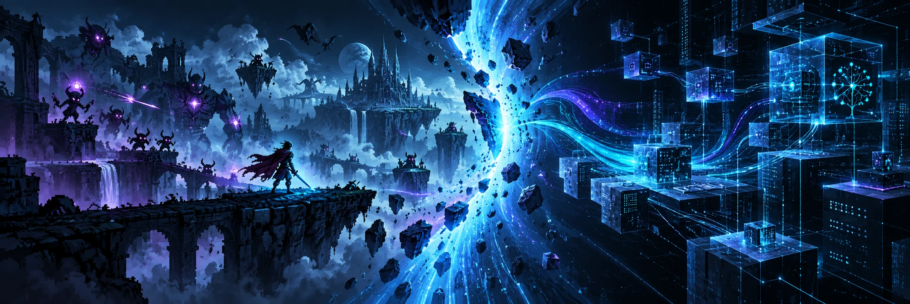

# Henrique Melo

**Desenvolvedor de software, criador de jogos independentes e estudante de Ciência da Computação.**

  
  
  

## Eu transformo ideias em experiências que as pessoas podem usar

Gosto de projetos que começam com uma pergunta difícil e terminam em algo que alguém consegue jogar, testar e sentir. Meu trabalho vive na interseção entre **game design**, **engenharia de software** e **produto**.

Isso significa pensar no combate e na progressão, mas também cuidar do multiplayer, da arquitetura, dos testes, do desempenho em celulares e do caminho que leva uma versão até o jogador. Não me interessa apenas fazer uma funcionalidade existir; quero que ela tenha identidade, seja sustentável e sobreviva ao uso real.

Hoje, meu principal laboratório é o **Ruptura Temporal**, um jogo autoral no qual reúno boa parte do que venho aprendendo sobre sistemas, narrativa, inteligência artificial, experiência do jogador e entrega multiplataforma.

## Projeto principal

<table>
  <tr>
    <td width="64%" valign="top">
      <h3><a href="https://github.com/HenryMelo23/Ruptura_Temporal-Godot-Mobile">Ruptura Temporal</a></h3>
      
Um roguelike de ação e power fantasy para Android, Windows e Linux. A experiência combina manifestações com identidades próprias, cartas, chefes, progressão de run e multiplayer online.

      
O projeto cresceu de um protótipo de combate para um produto completo, com sincronização host/cliente, conteúdo data-driven, telemetria, atualizador próprio e uma suíte com mais de <strong>280 testes automatizados</strong>.

      
<strong>O desafio que me move:</strong> criar uma experiência intensa e visualmente marcante sem abandonar estabilidade, desempenho mobile e evolução contínua do código.

      
<code>Godot</code> <code>GDScript</code> <code>Shaders</code> <code>Multiplayer</code> <code>Android</code>

    </td>
    <td width="36%" valign="top">
      <strong>Dentro do projeto</strong>
        Gameplay e balanceamento
       Bosses e sistemas de habilidades
       Multiplayer autoritativo
       UI para desktop e mobile
       Otimização e portabilidade
       Testes e publicação contínua
    </td>
  </tr>
</table>

## Outros projetos que completam o mapa

<table>
  <tr>
    <td width="33%" valign="top">
      <h3><a href="https://github.com/HenryMelo23/Ruptura_Temporal-APOLO2.0">APOLO</a></h3>
      
Laboratório de inteligência artificial ligado ao universo de Ruptura Temporal. Explora agentes adaptativos, Deep Q-Networks e a ponte entre pesquisa em Python e decisões dentro de um jogo real.

      
<code>Python</code> <code>PyTorch</code> <code>DQN</code>

    </td>
    <td width="33%" valign="top">
      <h3><a href="https://github.com/HenryMelo23/notas-no-bolso">Notas no Bolso</a></h3>
      
Aplicação musical com reconhecimento de altura pelo microfone, afinador e módulos de prática. Pensada para funcionar em desktop, web e Android, inclusive com conteúdo offline.

      
<code>TypeScript</code> <code>Electron</code> <code>Capacitor</code>

    </td>
    <td width="33%" valign="top">
      <h3><a href="https://github.com/HenryMelo23/SIGMon">SIGMon</a></h3>
      
Sistema integrado para gestão de monitorias acadêmicas, desenvolvido no contexto da Universidade de Brasília, com regras de acesso, dados relacionais e fluxos administrativos.

      
<code>Flask</code> <code>PostgreSQL</code> <code>SQL</code>

    </td>
  </tr>
</table>

## Como eu construo

| Produto | Engenharia | Entrega |
| :--- | :--- | :--- |
| Começo pela experiência e pelo problema que precisa ser resolvido. | Transformo decisões em contratos claros, módulos testáveis e comportamento previsível. | Levo o projeto até builds utilizáveis, observo o resultado e volto para a próxima iteração. |
| Prototipo cedo e preservo espaço para descobrir soluções melhores. | Trato desempenho, sincronização, compatibilidade e manutenção como parte da funcionalidade. | Prefiro progresso verificável a uma ideia que só funciona em apresentação. |

## Ferramentas e áreas de atuação

 

| Jogos | Aplicações | Backend e dados | Prática de engenharia |
| :--- | :--- | :--- | :--- |
| Godot, GDScript, shaders, UI e multiplayer | TypeScript, JavaScript, Electron, Capacitor e Angular | Python, Flask, Java, Spring e PostgreSQL | Git, Linux, Docker, testes, arquitetura e automação |

## O trabalho continua em movimento

 

## Vamos construir alguma coisa interessante

Se você trabalha com jogos, aplicações interativas, inteligência artificial ou produtos que exigem tanto criatividade quanto rigor técnico, será um prazer trocar experiências.

  <a href="https://github.com/HenryMelo23">GitHub</a> ·
  <a href="https://www.instagram.com/henri_meelo/">Instagram</a> ·
  <a href="https://github.com/HenryMelo23?tab=repositories">Repositórios</a>

  Código é o meio. A experiência que ele sustenta é o que importa.

